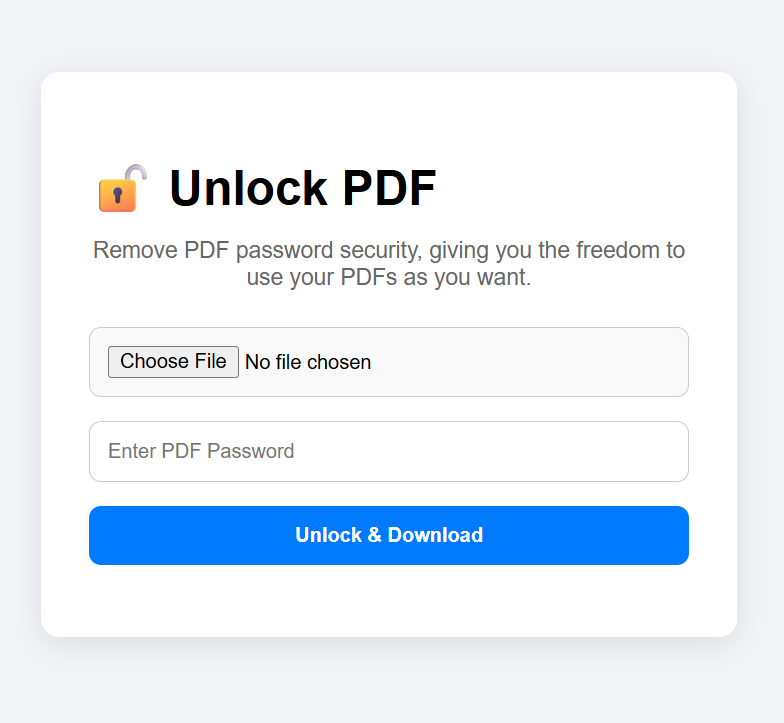

# 🔓 PDF Unlocker – Remove Password from Secured PDFs

A simple, self-hosted web app to upload password-protected PDF files, unlock them using the provided password, and download the unprotected version. Built with Node.js and `qpdf`, packaged in Docker for easy deployment.

---

## ✨ Features

- 🔐 Remove passwords from secured PDF files
- 📄 Keeps original filename (adds `_Unlocked`)
- 📱 Clean, mobile-responsive web UI
- 🚀 Dockerized for one-command deployment
- 🧩 Multi-arch image (amd64 + arm64), runs on any Docker host
- 🗑️ Uploaded and unlocked files are deleted right after download

---

## 📸 Demo



---

## 📂 Folder Structure

```bash
unlock-pdf/
├── .github/workflows/
│   └── release.yml      # CI/CD: checks + Docker Hub publish on tag
├── server.js
├── Dockerfile
├── docker-compose.yml
├── package.json
├── package-lock.json
├── public/
│   └── index.html
├── uploads/             # temp files, created at runtime, git-ignored
└── README.md
```

---

## 🐳 Run with Docker

Run directly:

```bash
docker run -p 3000:3000 jituboss/pdf-unlock
```

Or pin a version:

```bash
docker run -p 3000:3000 jituboss/pdf-unlock:1.1.0
```

To stop the container, press `Ctrl+C` or run:

```bash
docker stop $(docker ps -q --filter ancestor=jituboss/pdf-unlock)
```

---

## 🚀 Releasing

Pushing a `v*` tag builds a multi-arch image (amd64 + arm64) and pushes it to
[Docker Hub](https://hub.docker.com/r/jituboss/pdf-unlock) via GitHub Actions
(`.github/workflows/release.yml`). Pushes to `master` and pull requests only run the checks (dependency audit, an end-to-end unlock test, and image builds).

```bash
npm version patch          # or minor / major; bumps package.json and creates tag vX.Y.Z
git push origin master --follow-tags
```

Tags published: `X.Y.Z`, `X.Y`, `X`, `latest`. A prerelease such as `1.2.0-beta.1`
gets its exact version plus `beta`, never `latest`.

Requires repo secrets `DOCKERHUB_USERNAME` and `DOCKERHUB_TOKEN` (a Docker Hub access token with Read & Write).

---

## ⚙️ Docker Compose Example

```yaml
services:
  pdf-unlock:
    image: jituboss/pdf-unlock:latest
    container_name: pdf-unlock
    ports:
      - "3000:3000"
    restart: unless-stopped
```

Deploy with:

```bash
docker compose up -d
```

> Upgrading from 1.0.0: remove any `./uploads` volume mount. The container now runs as a
> non-root user and only uses `uploads/` for short-lived temp files.

---

## 💻 Run Locally

Requires Node.js 24+ and `qpdf` (`brew install qpdf` / `apt install qpdf`).

```bash
npm ci
npm start   # http://localhost:3000
```

---

## 🔐 Requirements

- A PDF file with password protection (max 50 MB)
- The correct password
- Docker system to run the container

---

## 🛡️ Security

- `qpdf` is invoked without a shell, so passwords and filenames can't inject commands
- Uploads are limited to a single PDF of up to 50 MB
- Passwords are never logged
- The container runs as a non-root user
- Files are stored under random server-generated names and removed after each request

This app has no authentication. Don't expose it to the public internet without putting it behind
a reverse proxy with auth.

---

## 📝 License

MIT © [jituboss](https://github.com/jituboss)

---

## 🌐 Credits

PDF unlocking powered by [qpdf](https://github.com/qpdf/qpdf)